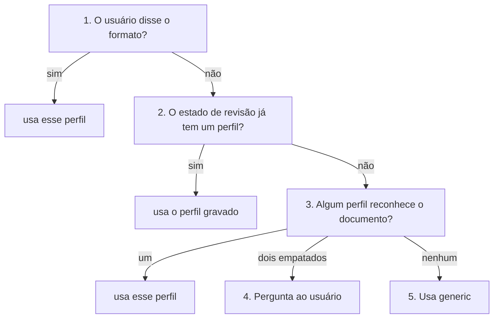
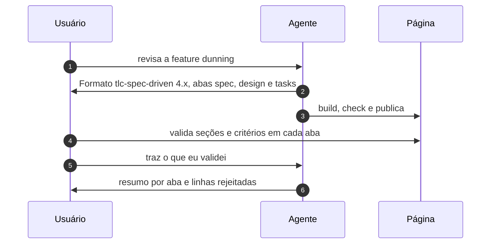

# Revisão unificada de documentos - design

Proposta para unir `plan-review` e `doc-review` em uma skill só, que monta a página de revisão de qualquer documento de design e reconhece os formatos que têm regras próprias (tlc-spec-lean e tlc-spec-driven). São três perfis: `generic`, `tlc-spec-lean` e `tlc-spec-driven`. Estado: **em validação**. Nada foi construído ainda; o nome da skill está em aberto.

## Objetivo

As duas skills fazem a mesma coisa: espelham um documento Markdown numa página, seção por seção, e deixam a pessoa validar cada seção e cada linha de tabela. Hoje o motor (validação no db, fingerprints, `STALE`, `RECHECK`, prova de cobertura, Mermaid com passo a passo, sync) está duplicado, e cada correção precisa ser feita duas vezes.

A skill unificada tem um núcleo genérico e **perfis**: um perfil diz como reconhecer um formato, quais arquivos fazem parte dele e o que, no texto, vira item revisável ou link. Um formato novo custa um arquivo de perfil, não um script novo.

A skill não escreve nem muda o documento. Ela entra depois de tlc-spec-lean ou tlc-spec-driven terem gerado o documento.

## Decisões

| #   | Decisão                                                                                                                   | Estado                         |
| --- | ------------------------------------------------------------------------------------------------------------------------- | ------------------------------ |
| 1   | Uma skill só: o núcleo vem do `doc-review`, e o `plan-review` vira o perfil `tlc-spec-lean`                               | proposta                       |
| 2   | Nome da skill                                                                                                             | em aberto, ver Pendências      |
| 3   | Uma página pode ter vários arquivos, um por aba (spec, design, tasks...), já na primeira versão                          | decidido                       |
| 4   | Quando o usuário diz o formato, a palavra dele vale, mesmo que a detecção aponte outro; o agente só avisa                | decidido                       |
| 5   | O formato é detectado sozinho e anunciado antes do build                                                                  | proposta                       |
| 6   | O perfil tlc-spec-driven parte da versão 4.x e aceita documentos da 3.x                                                   | proposta                       |
| 7   | Páginas já publicadas pelo `plan-review` e pelo `doc-review` mantêm o link e as validações                                | proposta                       |

## Como o formato é escolhido



1. O usuário disse o formato?
   - **Exemplo**: "revisa o spec.md como tlc-spec-driven", "usa o perfil genérico nesse plan.md".
   - **Se sim**: usa esse perfil, mesmo que a detecção aponte outro; o agente avisa a diferença numa linha e segue com o do usuário.
   - **Por quê**: a palavra do usuário vale mais que a detecção (decisão 4).
2. O estado de revisão já tem um perfil?
   - **Exemplo**: a página já foi publicada e o estado ao lado do documento guarda `"profile": "tlc-spec-lean"`.
   - **Se sim**: usa o perfil gravado, sem detectar de novo; só uma nova palavra do usuário troca o perfil.
   - **Por quê**: um rebuild não pode mudar de perfil sozinho, senão as chaves das validações mudam junto.
3. Algum perfil reconhece o documento?
   - **Como**: cada perfil confere o caminho e os headings obrigatórios do seu `detect`; o nome do arquivo sozinho não conta.
   - **Exemplo**: `.specs/features/dunning/spec.md` com `## User Stories` é tlc-spec-driven; um `plan.md` sem `Shape` e `Landing` não é tlc-spec-lean.
   - **Se um bate**: usa esse perfil e anuncia antes do build: `Formato: tlc-spec-driven 4.x (detectado por .specs/features/*/spec.md + "## User Stories")`.
4. Pergunta ao usuário
   - **Quando**: dois perfis reconhecem o documento com a mesma força.
   - **Exemplo**: um arquivo em `.specs/features/` que tem os headings obrigatórios dos dois perfis tlc.
   - **Depois**: grava a resposta no estado de revisão, e o passo 2 passa a valer nos próximos builds.
5. Usa generic
   - **Quando**: nenhum perfil reconhece o documento.
   - **Exemplo**: um TDD em `docs/tdd-robo.md`, ou um `plan.md` do plan mode do Claude Code.
   - **Resultado**: a página espelha o documento seção por seção, sem itens revisáveis além das seções e das linhas de tabela.

- O agente sempre diz qual perfil vai usar e por quê, antes do build: `Formato: tlc-spec-driven 4.x (detectado por .specs/features/*/spec.md + "## User Stories")`.
- Se o usuário disse um formato e a detecção aponta outro, vale o do usuário; o agente avisa a diferença numa linha.
- O nome do arquivo sozinho não decide. Um `plan.md` só é tlc-spec-lean se tiver os headings dele (`Shape` e `Landing`, ou `Flow` e `Impact` nos planos antigos); um `plan.md` do plan mode do Claude Code, escrito à mão ou de outra metodologia vai para `generic`, a menos que outro perfil o reconheça. Um arquivo no caminho de um perfil sem os headings dele também vai para `generic`, com um aviso.
- A escolha fica gravada no estado de revisão. Rebuilds e republicações não detectam de novo; só uma nova palavra do usuário troca o perfil.

## Estrutura da skill

```text
skills/{nome}/
  SKILL.md                  # procedimento único, com os gatilhos das duas skills de hoje
  scripts/
    extract_doc.py          # lê cada arquivo em seções e blocos (o parser do doc-review)
    profiles.py             # detecta o perfil e aplica as regras dele
    build_page.py           # monta a página, uma aba por arquivo
    check_page.cjs          # roda a página no jsdom e prova que mostra tudo
    coverage.py             # prova que cada pedaço de cada arquivo está na página, em ordem
    sync_review.py          # traz o que foi validado na página para o estado
  profiles/
    generic.json
    tlc-spec-lean.json      # + tlc_spec_lean.py: Where/Why/Proof, cards, doors
    tlc-spec-driven.json
  assets/template.html      # um template; os blocos de cada perfil ligam ou desligam
  references/
    profiles.md             # como escrever um perfil novo
    tlc-spec-lean.md        # o review-page-json.md de hoje
```

## Contrato de um perfil

| Campo      | Para que serve                                                         | Exemplo (tlc-spec-driven)                                  |
| ---------- | ---------------------------------------------------------------------- | ---------------------------------------------------------- |
| `detect`   | como reconhecer o documento: caminho e headings obrigatórios           | `.specs/features/*/spec.md` + `## User Stories`            |
| `files`    | quais arquivos vizinhos entram como abas, em que ordem                 | `spec.md`, `context.md`, `design.md`, `tasks.md`, `validation.md` |
| `approval` | a linha que diz se o documento está aprovado                           | `**Approved**:`                                            |
| `items`    | o que, além das linhas de tabela, ganha Confirm / Reject               | cada critério EARS, cada `### T1:`, cada `**C1**`          |
| `ids`      | os identificadores que o texto usa                                     | `DUN-01`, `T1`, `C1`, `AD-001`                             |
| `links`    | que campo aponta para qual identificador, inclusive em outra aba       | `**Depends on**: T1`, `**Requirement**: DUN-01`            |
| `versions` | headings que mudaram entre versões e o nome antigo de cada um          | 3.x sem `**Approved**:` nem `Differences from the source`  |

Um perfil só declara; quem renderiza, valida e prova a cobertura é o núcleo. O único perfil com código próprio é o `tlc-spec-lean`, porque Where / Why / Proof exigem ler o código do projeto.

```json
{
  "name": "tlc-spec-driven",
  "detect": { "path": ".specs/features/*/spec.md", "headings": ["User Stories"] },
  "files": ["spec.md", "context.md", "design.md", "tasks.md", "validation.md"],
  "approval": "**Approved**:",
  "items": [
    { "key": "ac", "in": "spec.md", "line": "^\\d+\\. (WHEN|IF|WHILE|WHERE|The system)" },
    { "key": "task", "in": "tasks.md", "heading": "^### (T\\d+):" },
    { "key": "check", "in": "tasks.md", "line": "^\\*\\*(C\\d+)\\*\\* -" }
  ],
  "links": [
    { "field": "Depends on", "to": "task" },
    { "field": "Requirement", "to": "spec.md#requirement" }
  ]
}
```

## A página com abas

Quando o perfil tem `files`, uma página mostra todos os arquivos da feature que existem, um por aba. O usuário pode também listar os arquivos ("revisa esses três docs numa página"); aí o perfil `generic` também ganha abas.

```text
┌────────────────────────────────────────────────────────────────────┐
│ dunning                    Aprovado: ainda não   · spec a1b2 · tasks 9f3c │
│ [ spec 4/6 ] [ design 2/7 ] [ tasks 0/9 ] [ validation - ]          │
├────────────────────────────────────────────────────────────────────┤
│ spec.md                                                            │
│ P1: Retry failed charge ⭐ MVP                         [Validate]  │
│   As a billing admin, I want ...                                   │
│   1  WHEN a charge fails THEN system SHALL retry ...   [✓] [✗]     │
│   2  IF the card expired THEN system SHALL notify ...  [✓] [✗]     │
│                                                                    │
│ Requirement Traceability                                           │
│   DUN-01  P1   tasks: T1, T3 ↗   checks: C1 ↗                      │
│   DUN-02  P1   tasks: T2 ↗       checks: C2 ↗                      │
└────────────────────────────────────────────────────────────────────┘
```

- Cada aba tem seu progresso (`4/6`), seu hash e seu `STALE`; a aba de um arquivo que mudou mostra "changed since" só no que mudou.
- Um link entre abas (`T1 ↗`) só existe quando o texto escreveu o identificador; nenhum vínculo é inventado.
- O estado de revisão fica num arquivo só, ao lado da feature, e as chaves no db levam o arquivo: `spec:ac:P1:2`, `tasks:task:T1`.
- A cobertura é provada por arquivo: `spec 212/212 · tasks 148/148`.
- Uma aba de arquivo que ainda não existe (`validation.md` antes do build) aparece desligada, com `-`.



## Perfis

| Perfil          | Reconhece                                                        | Abas                                          | O que ganha além do generic                                                                 |
| --------------- | ---------------------------------------------------------------- | --------------------------------------------- | ------------------------------------------------------------------------------------------- |
| generic         | qualquer Markdown que nenhum outro perfil reconhece              | uma, ou as que o usuário listar               | nada: é o doc-review de hoje                                                                |
| tlc-spec-lean   | `.specs/features/*/plan.md` com `Shape` e `Landing`              | uma (plan)                                    | abas Visual, cards Where / Why / Proof, doors, ACs como links, selo de aprovação           |
| tlc-spec-driven | `.specs/features/*/spec.md`, `design.md`, `tasks.md`             | spec, context, design, tasks, validation      | critérios EARS e tasks revisáveis um a um, Depends on e Requirement como links entre abas  |

## Páginas já publicadas

| Hoje                                         | Depois                                                                           |
| -------------------------------------------- | -------------------------------------------------------------------------------- |
| `review-page.json` do plan-review            | continua sendo lido e escrito pelo perfil tlc-spec-lean, com os mesmos campos    |
| `x-doc-review.json` do doc-review            | continua sendo o estado de um documento genérico de um arquivo só                |
| chaves no db (`problem`, `door:1`, `contexto`) | as de páginas de um arquivo não mudam; só páginas com abas usam o prefixo do arquivo |
| link do artifact                             | o mesmo; a republicação vai para a mesma `url`                                   |

## Etapas de construção

| #   | Etapa                                                                                    | Pronto quando                                                                 |
| --- | ---------------------------------------------------------------------------------------- | ----------------------------------------------------------------------------- |
| 1   | Separar o núcleo do doc-review e criar o perfil `generic`                                | os documentos de teste de hoje geram a mesma página, check ok e mesma cobertura |
| 2   | Portar o plan-review como perfil `tlc-spec-lean`                                         | um plano real com seu `review-page.json` passa no check como hoje             |
| 3   | Página com abas no núcleo                                                                | uma feature com vários arquivos passa no check, com cobertura por arquivo     |
| 4   | Perfil `tlc-spec-driven` (4.x e 3.x)                                                     | uma feature 4.x e uma 3.x geram página, com links entre abas                  |
| 5   | Apagar `skills/plan-review`, ajustar descrição, versão e README                          | `security-scan.sh` limpo                                                      |

## Riscos

| Risco                                                                                                   | Como tratar                                                                                   |
| ------------------------------------------------------------------------------------------------------- | --------------------------------------------------------------------------------------------- |
| O `md()` do plan-review é mais restrito que o do doc-review; o plano passa a renderizar mais            | mudar o `rendered_form` do `coverage.py` junto e comparar a página antiga e a nova de um plano real |
| Formatos de terceiros mudam de versão (a tlc-spec-driven foi da 3.3 para a 4.1)                         | o perfil lista os headings de cada versão; um heading desconhecido cai no genérico, sem perder texto |
| A página com abas fica pesada numa feature grande                                                       | só a aba aberta desenha Mermaid; as outras desenham ao abrir                                  |
| Um perfil declarativo não basta para algum formato                                                      | o contrato aceita um módulo Python opcional, como o do tlc-spec-lean                          |

## Fora do escopo

- Escrever ou corrigir o documento revisado: continua sendo trabalho de tlc-spec-lean, tlc-spec-driven ou do usuário.
- Aprovar o documento a partir das validações: aprovar é a palavra do usuário.
- Um perfil para a superpowers ou outras metodologias: ficam fora desta versão. Pelo contrato de perfil, entram depois como um arquivo novo em `profiles/`, sem mudar o núcleo.
- Documentos que não são Markdown local (Google Docs, Notion, PDF).

## Pendências

| #   | Nome candidato  | A favor                                                    | Contra                                              |
| --- | --------------- | ---------------------------------------------------------- | --------------------------------------------------- |
| 1   | `doc-review`    | já existe, os gatilhos já apontam para ele                 | soa como revisão de texto, não de spec              |
| 2   | `review-page`   | diz o que entrega: uma página de revisão                   | genérico demais para o gatilho                      |
| 3   | `spec-review`   | casa com o uso principal (specs de feature)                | um ADR ou runbook não é spec                        |
| 4   | `design-review` | cobre TDD, ADR, RFC e specs                                | pode confundir com revisão de design visual         |
