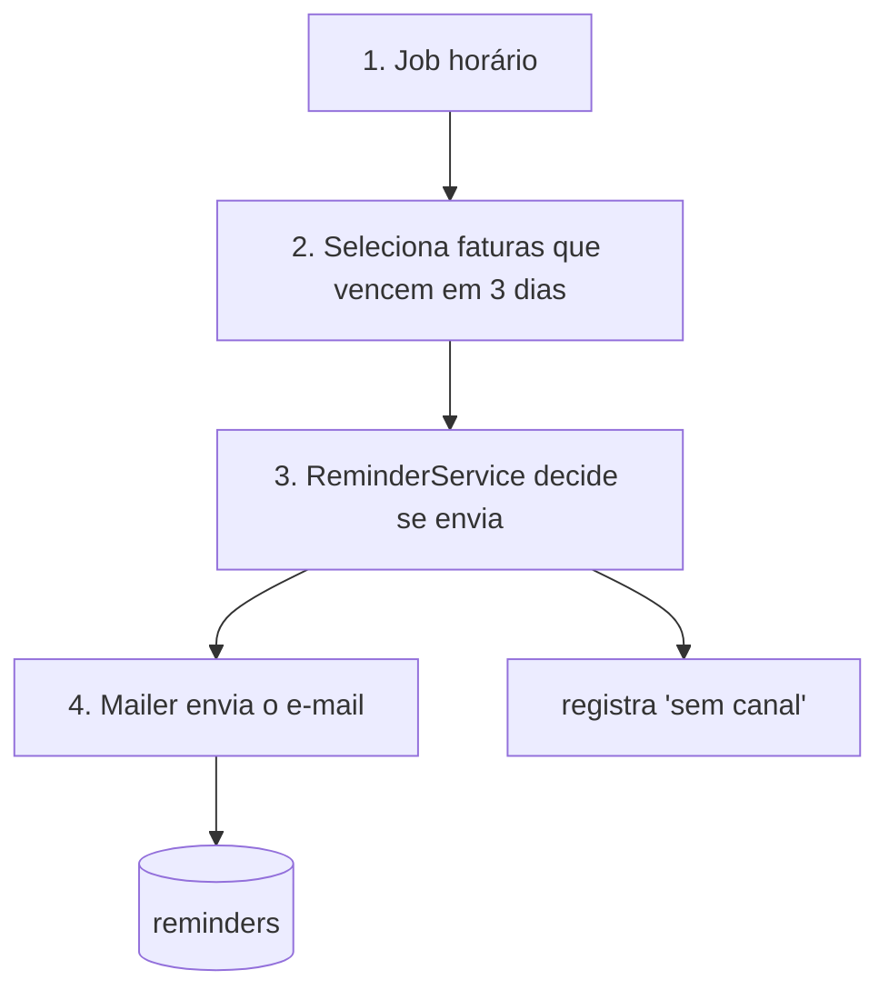

# Lembrete de vencimento Design

**Spec**: `.specs/features/lembrete-vencimento/spec.md`
**Status**: Approved

---

## Architecture Overview

Um job agendado roda a cada hora, separa as faturas que vencem em 3 dias e cujo cliente está às 9h no fuso dele, e manda cada uma para o serviço de lembrete, que decide se envia e registra o envio.



---

## Code Reuse Analysis

### Existing Components to Leverage

| Component      | Location                         | How to Use                         |
| -------------- | -------------------------------- | ---------------------------------- |
| Mailer         | `src/mail/mailer.ts`             | Import: envia com template novo    |
| Scheduler      | `src/jobs/scheduler.ts`          | Extend: registra o job horário     |
| CustomerPrefs  | `src/customers/prefs.ts`         | Reference: lê a preferência        |

### Integration Points

| System    | Integration Method                              |
| --------- | ----------------------------------------------- |
| Faturas   | consulta `invoices` por vencimento e status     |
| Banco     | tabela nova `reminders`, uma linha por fatura   |

---

## Components

### ReminderService

- **Purpose**: decide se uma fatura recebe lembrete e registra o resultado.
- **Location**: `src/reminders/`
- **Interfaces**:
  - `shouldSend(invoice: Invoice): Decision` - aplica pago, sem canal, preferência e duplicado
  - `record(invoice: Invoice, decision: Decision): void` - grava em `reminders`
- **Dependencies**: CustomerPrefs, repositório de `reminders`
- **Reuses**: o padrão de serviço de `src/services/base.ts`

### ReminderJob

- **Purpose**: roda a cada hora e envia os lembretes da janela das 9h.
- **Location**: `src/jobs/reminder-job.ts`
- **Interfaces**:
  - `run(now: Date): Promise<number>` - devolve quantos e-mails saíram
- **Dependencies**: Scheduler, ReminderService, Mailer
- **Reuses**: `src/jobs/scheduler.ts`

---

## Data Models (if applicable)

### Reminder

```typescript
interface Reminder {
  invoiceId: string
  status: 'sent' | 'no_channel'
  sentAt: Date
}
```

**Relationships**: uma linha por fatura; `invoiceId` é único, o que garante um lembrete só.

---

## Error Handling Strategy

| Error Scenario          | Handling                                  | User Impact            |
| ----------------------- | ----------------------------------------- | ---------------------- |
| Mailer fora do ar       | não grava `reminders`; a próxima hora tenta de novo | o e-mail sai até 1h depois |
| Fuso do cliente ausente | usa o fuso da empresa                     | e-mail às 9h de Brasília |

---

## Risks & Concerns

| Concern | Location (file:line) | Impact | Mitigation |
| ------- | -------------------- | ------ | ---------- |
| Job e envio em paralelo podem duplicar | `src/jobs/scheduler.ts:40` | dois e-mails para a mesma fatura | `invoiceId` único em `reminders` (LEMB-02) |

---

## Tech Decisions (only non-obvious ones)

| Decision            | Choice                      | Rationale                                  |
| ------------------- | --------------------------- | ------------------------------------------ |
| Garantia de um envio | índice único no banco       | o job pode rodar duas vezes na mesma hora  |
